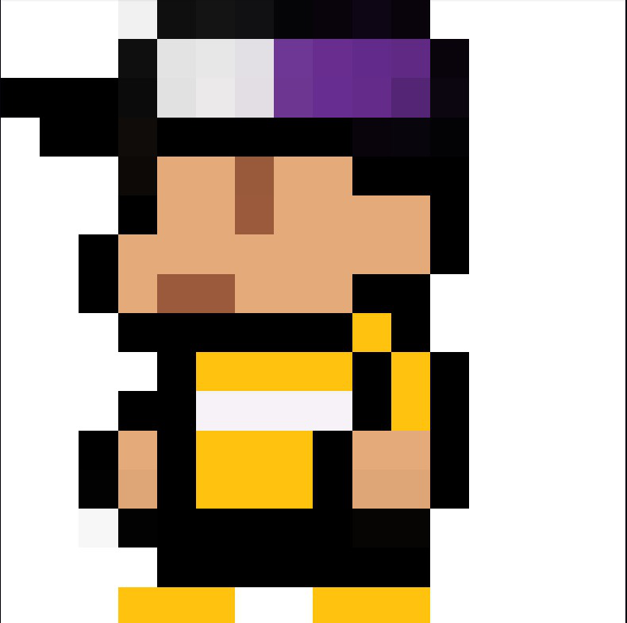
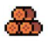
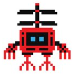
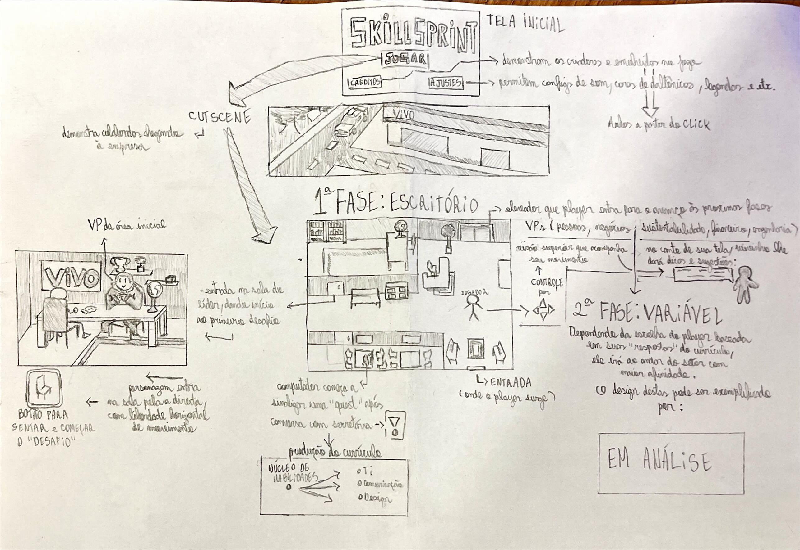
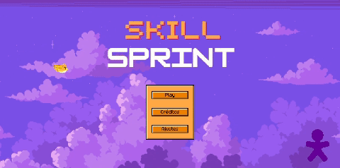
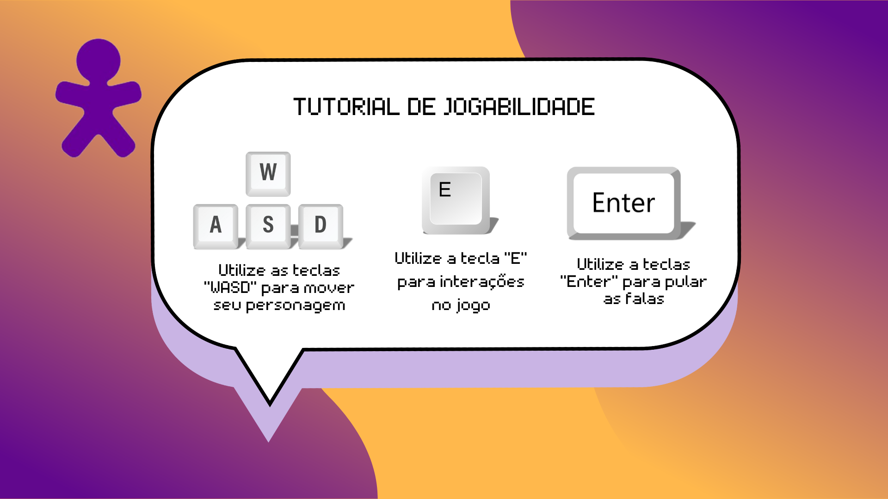
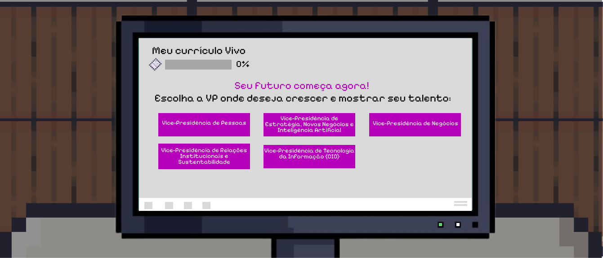
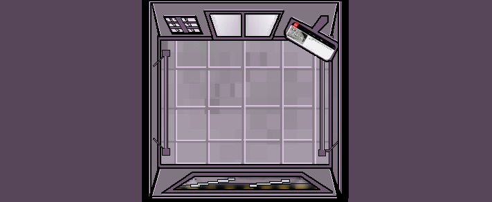
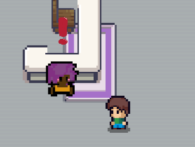
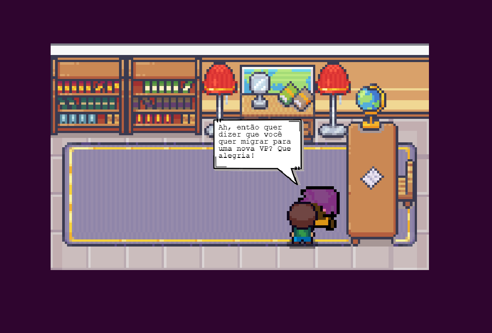

# GDD - Game Design Document - Módulo 1 - Inteli

## *SkillSprint Game* 
## *SkillMakers*
#### Nomes dos integrantes do grupo
- <a href="https://www.linkedin.com/in/mike-buchsenspaner-445a2934b/">Mike Buchsenspaner
- <a href="https://www.linkedin.com/in/sophia-hochman-b821a4346/?utm_source=share&utm_campaign=share_via&utm_content=profile&utm_medium=ios_app">Sophia Hochman
- <a href="https://www.linkedin.com/in/jaime-andrade-de-almeida-0777ba2a5/">Jaime Andrade de Almeida
- <a href="https://www.linkedin.com/in/anneestherlf?utm_source=share&utm_campaign=share_via&utm_content=profile&utm_medium=ios_app">Anne Esther Lins Figueirôa
- <a href="https://www.linkedin.com/in/marcela-costa-844b42338/)"> Marcela Amorim da Costa
- <a href="https://www.linkedin.com/in/arthur-marques-5b1080346?utm_source=share&utm_campaign=share_via&utm_content=profile&utm_medium=ios_app)">Arthur Marques
- <a href="https://www.linkedin.com/in/victorbarq/">Lucas Carvalho dos Ramos

## Sumário

[1. Introdução](#c1)

[2. Visão Geral do Jogo](#c2)

[3. Game Design](#c3)

[4. Desenvolvimento do jogo](#c4)

[5. Casos de Teste](#c5)

[6. Conclusões e trabalhos futuros](#c6)

[7. Referências](#c7)

[Anexos](#c8)

<br>

# <a name="c1"></a>1. Introdução (sprints 1 a 4)

## 1.1. Plano Estratégico do Projeto

### 1.1.1. Contexto da indústria (sprint 2)

A Vivo é uma empresa de telecomunicações e tecnologia no Brasil que oferece telefonia móvel e fixa, internet, TV por assinatura e serviços digitais. Fazendo parte do grupo “Telefônica”, investe em fibra óptica e 5G. Seus principais concorrentes são Claro, TIM e operadoras regionais. O setor é altamente competitivo, com foco em inovação, IoT (internet das coisas), inteligência artificial e *Open Finance* [1]. A Vivo se destaca pela liderança no pós-pago e maior base de fibra óptica, enfrentando o desafio de manter sua posição frente à concorrência e à evolução tecnológica.

Os principais *players* da indústria de telecomunicações no Brasil são empresas que competem diretamente no mercado. Esses *players* incluem a Vivo (líder em número de clientes [2]; possui diferencial de portfólio diversificado de serviços), a Claro [3] (segunda maior operadora do Brasil; possui como diferencial o foco em pacotes combinados de telefonia, internet e TV), a TIM [4] (terceira maior operadora; possui preços competitivos), a Oi [5], Algar Telecom [6] e Sky [7] (entre outros regionais). A Vivo também possui concorrentes indiretos de *streaming* e *over-the-top* (OTT) [8], plataformas como Netflix, Amazon Prime e YouTube competem indiretamente no segmento de entretenimento, impactando a demanda por serviços de TV por assinatura.

As tendências do mercado são a expansão do 5G (garante maior velocidade e conectividade), convergência de serviços (pacotes combinados com diferentes serviços de comunicação), digitalização e IoT, principalmente para empresas. Esses *players* e tendências mostram um mercado altamente competitivo, onde a Vivo se mantém como líder, mas precisa continuar inovando para enfrentar a concorrência direta e indireta. 

#### 1.1.1.1. Modelo de 5 Forças de Porter (sprint 2)

O modelo das 5 Forças de Porter [9], desenvolvido por Michael E. Porter, é uma ferramenta estratégica utilizada para analisar a competitividade de um setor. Ele avalia cinco forças que moldam a concorrência: 1) rivalidade entre concorrentes, 2) ameaça de novos entrantes, 3) poder de barganha dos fornecedores, 4) poder de barganha dos clientes e 5) ameaça de produtos substitutos. No caso da Vivo, líder do setor de telecomunicações no Brasil, a aplicação desse modelo é essencial para identificar oportunidades de crescimento e ameaças que podem impactar a sustentabilidade do negócio.

#### 1. Ameaça de Novos Entrantes
Relativamente baixa. A indústria de telecomunicações enfrenta barreiras significativas para novos entrantes, como altos custos de infraestrutura, exigências regulatórias complexas e grandes investimentos em tecnologia, como 5G. As operadoras líderes, como Vivo, Claro e TIM, já possuem bases sólidas de clientes e um forte posicionamento no mercado. No entanto, pequenos provedores de internet (ISPs) [10] regionais e operadoras focadas em nichos podem oferecer soluções mais acessíveis e personalizadas, impactando a participação das grandes operadoras em segmentos específicos, como dados e conectividade empresarial. Isso pode criar uma concorrência regionalizada e reduzir o domínio das grandes empresas.

#### 2. Ameaça de Produtos ou Serviços Substitutos:
Moderada/alta. Produtos e serviços substitutos, como internet via satélite, Wi-Fi comunitário, plataformas de *streaming* e soluções móveis inovadoras, estão se tornando alternativas à telefonia fixa e TV por assinatura. Além disso, serviços de VoIP [11] (tecnologia que permite a realização de chamadas de voz por meio da internet), como WhatsApp e Skype, substituem chamadas telefônicas tradicionais. A ameaça de substitutos é moderada, pois, embora essas alternativas digitais cresçam, a infraestrutura das operadoras tradicionais e a demanda por serviços de alta velocidade, como fibra óptica, garantem que as grandes operadoras permaneçam competitivas. Assim, apesar da inovação, as operadoras ainda têm uma vantagem significativa em muitos segmentos de mercado.
 
#### 3. Poder de Barganha dos Fornecedores:
Moderado. Os principais fornecedores da indústria de telecomunicações incluem empresas de equipamentos de rede, como Huawei e Ericsson, fornecedores de infraestrutura como fibra óptica, e empresas de conteúdo digital, como Netflix e Amazon. O poder de barganha dos fornecedores é moderado, pois as operadoras têm alternativas para a construção de suas redes. No entanto, a necessidade de tecnologias avançadas, como 5G, e a concentração de alguns fornecedores no mercado global aumentam sua influência. Isso é especialmente relevante nas negociações para fornecimento de equipamentos e licenciamento de tecnologia, onde os fornecedores têm maior poder devido à especialização e escassez.

#### 4. Poder de Barganha dos Clientes: 
Alto. A base de clientes da indústria de telecomunicações é diversificada, incluindo consumidores residenciais (usuários de telefonia, internet e TV) e empresas (que demandam soluções de conectividade, cloud computing e segurança cibernética). O poder de barganha dos clientes é alto, devido à saturação do mercado e à ampla oferta de pacotes das operadoras concorrentes. A facilidade de troca de operadora, aliada à crescente competitividade em preços, serviços e atendimento ao cliente, coloca pressão sobre as operadoras para oferecer condições melhores e fidelizar seus consumidores, tornando o mercado mais dinâmico e com maior exigência de qualidade.

#### 5. Rivalidade entre Concorrentes Existentes:
Alta. As principais concorrentes da Vivo são Claro, TIM, e operadoras regionais, como Algar e Brisanet, que oferecem serviços de internet de alta qualidade. A rivalidade no setor é alta, com as operadoras competindo principalmente por preço, qualidade de serviço e inovação tecnológica. A crescente demanda por convergência de serviços (telefonia, internet e TV) e a implementação do 5G intensificam ainda mais a competição, levando as operadoras a investir constantemente em infraestrutura e em ofertas diferenciadas para se manterem competitivas no mercado altamente dinâmico e saturado.

A análise pode ser observada na imagem a seguir:

<div align="center">
  <sub>Gráfico 5 forças de Porter</sub><br>
  <br>
  <sup>Fonte: produzido pelo autor.</sup>
</div>


### 1.1.2. Análise SWOT (sprint 2)

A análise SWOT [12] é uma ferramenta estratégica usada para avaliar os pontos fortes, fracos, oportunidades e ameaças de uma organização. Ela permite identificar fatores internos e externos que podem influenciar o desempenho da empresa, ajudando na tomada de decisões e no planejamento estratégico. Essa análise proporciona uma visão clara do cenário em que a organização está inserida.

A Vivo, líder de mercado no Brasil, destaca-se pela forte presença em telefonia móvel, internet fixa (fibra óptica) e inovação com 5G. Sua dependência de grandes investimentos em infraestrutura e a intensa concorrência de operadoras como Claro e TIM representam fraquezas. Entretanto, as oportunidades incluem a expansão do 5G, IoT e a integração com *fintechs*, além de soluções digitais para empresas. As ameaças vêm da saturação do mercado móvel e de mudanças regulatórias. A Vivo precisa manter sua liderança diante de uma concorrência crescente e exigente, como é apresentado no esquema abaixo.

<div align="center">
  <sub>Gráfico 5 forças de Porter</sub><br>
  <br>
  <sup>Fonte: produzido pelo autor.</sup>
</div>

### 1.1.3. Missão / Visão / Valores (sprint 2)

Missão, visão e valores são elementos essenciais para guiar a estratégia e as ações de uma organização. A missão define o propósito e os objetivos principais, a visão descreve onde a empresa deseja chegar no futuro, e os valores representam os princípios que orientam o comportamento e as decisões. Juntos, esses elementos formam a base para o sucesso e a sustentabilidade organizacional da Vivo.

#### Missão:
A missão da Vivo é “digitalizar para aproximar" [13]. Agir com transparência e consolidar uma relação de confiança com todas as partes interessadas e com os diferentes perfis de público e tornar a empresa cada vez mais responsável.

#### Visão:
A Vivo acredita que a revolução tecnológica deve ser parte da vida de todas e todos [14], e não um privilégio de poucos. A empresa almeja que as oportunidades que o mundo digital oferece sejam universais, contribuindo como uma força positiva para a transformação individual, das empresas e da sociedade.

#### Valores:
Integridade: Agir com honestidade e ética em todas as ações.
Compromisso: Cumprir promessas e agir de forma responsável.
Inovação: Buscar constantemente novas soluções e tecnologias.
Responsabilidade Social: Contribuir para o desenvolvimento social e ambiental.
Excelência: Buscar a qualidade em produtos, serviços e atendimento.

Atualmente, a Vivo conta com o Plano de Negócios responsável, que é distribuído por pilares de atuação: experiência do cliente, ética e transparência, responsabilidade corporativa, gestão ambiental e mudanças climáticas, sustentabilidade para a cadeia de valor, diversidade e talentos.

Com isso, esses são os princípios que guiam as tomadas de decisões e estratégias da Vivo.

### 1.1.4. Proposta de Valor (sprint 4)

O Value Proposition Canvas é uma ferramenta poderosa de planejamento estretégico dividida em dois blocos, Perfil do Cliente e Mapa de Valor, utilizada para desenvolver soluções e serviços eficazes voltados nas necessidades dos clientes. A ferramenta é projetada para promover o alinhamento e a compreensão profunda das dores do cliente, permitindo que a solução atenda da melhor forma a demanda do mercado. Sua utilização auxilia na melhoria contínua se moldando com base no feedback do cliente, a fim de entregar o melhor serviço além de potencializar o trabalho entregue por ter um direcionamento mais claro sobre o que será produzido.

<div align="center">
  <sub>Canvas Proposta de Valor</sub><br>
  <br>
  <sup>Fonte: produzido pelo autor.</sup>
</div>


### 1.1.5. Descrição da Solução Desenvolvida (sprint 4)

*Descreva brevemente a solução desenvolvida para o parceiro de negócios. Descreva os aspectos essenciais para a criação de valor da ideia do produto com o objetivo de ajudar a entender melhor a realidade do cliente e entregar uma solução que está alinhado com o que ele espera. Observe a seção 2 e verifique que ali é possível trazer mais detalhes, portanto seja objetivo aqui. Atualize esta descrição até a entrega final, conforme desenvolvimento.*

### 1.1.6. Matriz de Riscos (sprint 4)

Bug no som de exclamação da sala do líder
 - Corrigir o áudio na engine de desenvolvimento e testar em diferentes dispositivos.


Desinteresse por parte dos jogadores
 - Realizar testes com usuários e ajustar a dinâmica do jogo com base no feedback.


Jogo não contempla a diversidade dos funcionários
 -Incluir representatividade nos personagens e opções de escolha inclusivas.


O jogo não está concluído
 - Estabelecer cronograma com entregas parciais e checkpoints de progresso.


O jogo não é compatível com smartphones
 - Implementar design responsivo e realizar testes em diferentes dispositivos móveis.


Risco de direitos autorais por uso de trilha licenciada
 - Substituir trilhas por músicas royalty-free ou composições originais.


Erro na documentação
 - Revisar a documentação com checklist e atribuir responsáveis por cada seção.


Assets sem padronização
 - Criar guia de estilo visual e revisar todos os assets gráficos do jogo.


Empresa parceira não aprova a dinâmica do jogo
 - Envolver a empresa parceira nas fases iniciais e validar conceitos com protótipos.


*Registre na matriz os riscos identificados no projeto, visando avaliar situações que possam representar ameaças e oportunidades, bem como os impactos relevantes sobre o projeto. Apresente os riscos, ressaltando, para cada um, impactos e probabilidades com plano de ação e respostas.*

### 1.1.7. Objetivos, Metas e Indicadores (sprint 4)

*Definição de metas SMART (específicas, mensuráveis, alcançáveis, relevantes e temporais) para seu projeto, com indicadores claros para mensuração*

## 1.2. Requisitos do Projeto (sprints 1 e 2)

No *kick-off* com o parceiro, realizado em 07/02/2024, a Vivo delineou os principais aspectos para o desenvolvimento do MVP. A Tabela 1 a seguir apresenta os requisitos fundamentais para a construção da solução proposta, garantindo alinhamento com as expectativas da empresa parceira.
 
Tabela 1
\# | Requisito  
--- | ---
R01 | O controle do personagem será realizado usando as teclas WASD e a tecla E para interações gerais.
R02 | O jogo terá uma tela de abertura, onde o jogador inicia clicando em "Jogar". 
R03 | O jogo iniciará com uma cutscene, onde serão ilustrados o contexto e a ambientação inicial do jogo.
R04 | O jogador deve seguir as instruções dos diálogos dos NPCs para passar de fase, apertando a tecla "Enter" para avançar nas falas.
R05 | A primeira tela de jogabilidade será um escritório onde o jogador realizará suas primeiras interações no jogo.
R06 | A primeira fase terá um quiz sobre elaboração de currículo em um computador (objetivo: ensinar a criar um currículo atrativo e eficaz).
R07 | Todas as fases terão como objetivo motivar o usuário a realizar o *Job Rotation* na Vivo.
R08 | O jogo terá um *Game Design Document* completo e detalhado. 
R09 | As características dos personagens devem refletir o valor de diversidade da Vivo e trazer representatividade para o jogo.
R10 | O jogador terá, como ferramenta de *gameplay*, um assistente que lhe fornecerá dicas.
R11 | O código do jogo deverá ser segmentado de maneira à priorizar a organização e didática.
R12 | O jogo contará com diferentes trilhas sonoras, personalizadas para diferentes contextos dentro do jogo.
R13 | A segunda tela de jogabilidade será a sala do líder, onde o jogador finaliza sua missão do primeiro nível.
R14 | A movimentação entre os níveis do jogo acontecerá através do elevador, onde cada andar do prédio da Vivo representa uma fase do jogo.
R15 | A segunda fase será no escritório da Vice-Presidência de Pessoas e contará com uma simulação de situação de resolução de problemas (objetivo: preparar os jogadores para dinâmicas de entrevistas).
R16 | O design visual do jogo utilizará uma paleta de cores consistente e coerente, alinhada ao tema e à atmosfera proposta.
R17 | Utilizaremos algumas movimentações bidimensionais de elementos gráficos no jogo, utilizando conhecimentos sobre vetores e cinemática.
R18 | O jogo contará com um botão de ajustes que proporciona acessibilidade com filtro de daltonismo e ajuste de volume. 
R19 | A terceira fase será na Vice-Presidência de Negócios e contará com 2 minigames dinâmicos (objetivo: preparar os jogadores para resolução de cases).
R20 | A quarta fase será na Vice-Presidência de Estratégia, Novos Negócios e Inteligência Artificial e contará com 1 minigame (objetivo: ensinar a estruturar um plano de carreira).
R21 | A quinta fase será na Vice-Presidência de Relações Institucionais e terá 1 minigame (objetivo: orientar sobre feedbacks e acompanhamento de desempenho).
R22 | A sexta e última fase do jogo será na Vice-Presidência de Tecnologia da Informação e terá 1 minigame (objetivo: incentivar o aprendizado contínuo - upskilling e reskilling).

## 1.3. Público-alvo do Projeto (sprint 2)

O jogo é destinado a colaboradores da Vivo que desejam impulsionar sua carreira e buscar novas oportunidades dentro da própria empresa. Em termos demográficos, o público-alvo abrange profissionais geralmente entre 25 e 45 anos, com experiência acumulada e formação diversificada — desde cursos técnicos até graduações e pós-graduações. Além disso, a empresa cultiva um ambiente inclusivo com foco em diversos grupos, como gênero, raça, LGBTI+, PCD (Pessoas com Deficiência) e pessoas com mais de 50 anos, onde 45% dos colaboradores são mulheres e 42,9% dos colaboradores são negros (fonte: Material Onboarding Executivo; Vivo, Inteli; fev/2025).

# <a name="c2"></a>2. Visão Geral do Jogo (sprint 2)

## 2.1. Objetivos do Jogo (sprint 2)

O principal objetivo do Skill Sprint é proporcionar aos colaboradores da Vivo uma experiência interativa e estruturada para o desenvolvimento de carreira, superando desafios relacionados à falta de engajamento e acessibilidade nos programas tradicionais.

No jogo, os participantes percorrem diferentes etapas do crescimento profissional, desde a candidatura a novas oportunidades até o planejamento contínuo de desenvolvimento, promovendo a cultura de mobilidade interna e aprendizado contínuo.

Por meio de desafios dinâmicos e da prática do *job rotation* [15], os jogadores exploram novas áreas dentro da empresa, ampliando suas habilidades e alinhando-se aos valores e oportunidades da Vivo. Com essa abordagem gamificada, o Skill Sprint transforma o desenvolvimento de carreira em uma jornada envolvente e acessível, aumentando a adesão aos programas de capacitação e otimizando os recursos investidos em treinamentos tradicionais.

Para avançar e concluir o jogo, o jogador deve:
- Aprender os comandos de movimentação (teclas "A", "W", "S" e "D" do teclado) e interação com elementos (tecla “E”);
- Interagir e seguir as instruções fornecidas pelos personagens (até o presente momento de ideação existem 3 NPCs [16]: Vivinho, Vivita e o líder);
- Finalizar as tarefas de cada fase do jogo, aprendendo sobre as oportunidades existentes em cada Vice-Presidência.

Os objetivos de cada fase do jogo são:

##### Fase 1: Criação do Currículo no Escritório da Vivo
- **Objetivo da fase:** Ensinar a criar um currículo atrativo e eficaz.
- **Aprendizado:** Construção e otimização de currículo.
- **Conteúdos:** Dicas de *layout*, palavras-chave, adaptação para ATS [17] (*Applicant Tracking System*), destaque de conquistas.
- **Desafio (objetivo do jogador):** Cumprir a introdução ao jogo com Vivinho, seguir instruções da recepcionista (Vivita), criar o currículo no computador através das perguntas do *minigame* e entregá-lo à líder.

##### Fase 2: Entrevista de Processo Seletivo na Vice-Presidência de Pessoas
- **Objetivo:** Preparar os jogadores para dinâmicas de entrevistas.
- **Aprendizado:** Desenvolvimento de habilidades para entrevistas.
- **Conteúdos:** Dicas de entrevistas, exemplos de perguntas e simulação de entrevista.
- **Desafios (objetivo do jogador):** Resolver case, simulação de entrevista com feedback.

##### Fase 3: Resolução de Case na Vice-Presidência de Negócios
- **Objetivo:** Preparar os jogadores para resolução de cases.
- **Aprendizado:** Desenvolvimento de habilidades para resolução de cases.
- **Conteúdos:** Estratégias para resolver cases.
- **Desafios (objetivo do jogador):** Resolver um case relacionado ao setor de Negócios na Vivo.

##### Fase 4: Planejamento e desenvolvimento de carreira na Vice-Presidência de Estratégia, Novos Negócios e Inteligência Artificial
- **Objetivo:** Ensinar a estruturar um plano de carreira.
- **Aprendizado:** Planejamento de carreira e metas de desenvolvimento.
- **Conteúdos:** Estratégias para resolver cases, dicas de entrevistas, exemplos de perguntas e boas práticas.
- **Desafios (objetivo do jogador):** Criar plano de desenvolvimento, *feedback* fictício.

##### Fase 5: Jantar com gestores na Vice-Presidência de Relações Institucionais
- **Objetivo:** Orientar sobre *feedbacks* e acompanhamento de desempenho.
- **Aprendizado:** Importância do *feedback* e conversas com gestores.
- **Conteúdos:** Práticas para *feedback*, ciclo de desempenho, comunicação com liderança.
- **Desafios (objetivo do jogador):** Simulação de conversa com o gestor, resolver dilemas de desempenho.

##### Fase 6: Upskilling e Reskilling [18] na Vice-Presidência de Tecnologia da Informação
- **Objetivo:** Incentivar o aprendizado contínuo.
- **Aprendizado:** Desenvolvimento de novas habilidades para adaptação ao mercado.
- **Conteúdos:** Diferença entre *upskilling* e *reskilling*, ferramentas de desenvolvimento.
- **Desafios:** Identificar *skills* relevantes, criar plano de aprendizado.

Diante do exposto, entende-se que o jogo é estruturado de forma a contemplar o requisito sete (R07), voltado para o estímulo da rotação de carreira no ambiente corporativo da Vivo. Todas as fases possuem o objetivo de instruir, em forma de *serious game*, as boas práticas de uma aplicação de qualidade em um processo seletivo interno empresarial. O objetivo geral é motivar o jogador a realizar o *job rotation* após entender claramente o passo-a-passo para esse processo jogando Skill Sprint.

## 2.2. Características do Jogo (sprint 2)

O jogo Skill Sprint se passa em um ambiente virtual que simula a jornada de desenvolvimento de carreira dentro da Vivo. Por ser um *serious game* [19], seu principal objetivo é utilizar a mecânica e a dinâmica dos jogos para promover aprendizado, treinamento ou conscientização em um contexto fora do entretenimento tradicional. Esses jogos são projetados para alcançar um objetivo educativo, como o desenvolvimento de habilidades, a simulação de situações reais, ou a transmissão de informações importantes de uma maneira envolvente e interativa. Enquanto os jogos tradicionais têm como foco a diversão e o entretenimento, os serious games buscam impactar positivamente a formação de uma pessoa ou de uma comunidade.

Dessa forma, o Skill Sprint desempenha o papel de um “jogo sério”, de cunho didático, de forma inspiradora e dinâmica. O personagem principal está no prédio empresarial da Vivo e é convidado a conhecer as Vice-Presidências da empresa após submeter seu currículo na sala do líder (1ª fase). O jogador explora diferentes setores e desafios do processo de candidatura para processos internos, como o momento de *feedback* com gestores, por exemplo, passando por processos de recrutamento, desenvolvimento profissional e aprendizado contínuo. Cada fase do jogo reflete um aspecto essencial desse processo, proporcionando uma experiência imersiva.

Os jogadores enfrentam desafios interativos que representam situações reais do mercado de trabalho, incluindo a criação de currículo, participação em entrevistas, resolução de cases e planejamento de carreira. O jogo utiliza elementos de RPG [20] para permitir a evolução do personagem, incentivando a progressão baseada no aprendizado e na tomada de decisões estratégicas.

A narrativa envolvente conduz os jogadores por um caminho estruturado de desenvolvimento profissional, utilizando NPCs carismáticos como guias e mentores. O enredo dinâmico reforça a importância da mobilidade interna e do aprendizado contínuo, destacando o papel da Vivo no crescimento de seus colaboradores.

O jogo promove o desenvolvimento de competências essenciais para o crescimento na carreira, como habilidades de comunicação, resolução de problemas e planejamento estratégico. Além disso, a progressão do jogador reflete sua evolução no domínio dessas competências, tornando o aprendizado prático e recompensador.

### 2.2.1. Gênero do Jogo (sprint 2)

O Skill Sprint combina elementos de RPG, simulação e estratégia para oferecer uma experiência interativa de aprendizado. O jogador assume o papel de um profissional em ascensão dentro da Vivo, navegando pelos desafios do mercado de trabalho de forma dinâmica.

RPG (*Role-Playing Game*, ou "Jogo de Interpretação de Papéis", em português) é um tipo de jogo onde os jogadores assumem o papel de personagens fictícios em um mundo imaginário. O objetivo principal é interpretar e viver uma narrativa ou história por meio das ações e decisões desses personagens, dentro de um conjunto de regras estabelecido. Por isso, um elemento essencial do nosso jogo são os NPCs, (*Non-Player-Characters* – personagens que não são controlados por nenhum jogador, mas sim pelo sistema do jogo) personagens interativos que informam e guiam sobre as missões no jogo.

### 2.2.2. Plataforma do Jogo (sprint 2)

A jogabilidade será acessível através de navegadores compatíveis (até o momento testamos: Chrome), permitindo que os colaboradores da Vivo possam jogá-lo em *desktop*. Essa escolha garante acessibilidade no ambiente corporativo. Futuramente, planejamos adaptá-lo para dispositivos móveis, permitindo, assim, que os jogadores participem da experiência em diferentes momentos do seu dia.

### 2.2.3. Número de jogadores (sprint 2)

O Skill Sprint é um jogo single-player, projetado para oferecer uma experiência individual de aprendizado e desenvolvimento. Esse formato garante que cada jogador possa avançar no seu próprio ritmo, maximizando a absorção do conteúdo e a aplicação prática dos conhecimentos adquiridos.

### 2.2.4. Títulos semelhantes e inspirações (sprint 2)

O desenvolvimento do Skill Sprint foi inspirado por títulos que combinam aprendizado e dinâmica de maneira eficaz. Algumas das principais referências incluem:

- Pokémon [21]: A mecânica de evolução dos personagens e a exploração de diferentes mundos em Pokémon inspirou a estrutura de progressão de carreira no **Skill Sprint**. Assim como em Pokémon, os jogadores avançam ao completar desafios e aprimorar suas habilidades;
  
- Stardew Valley [22]: A interação com NPCs e o desenvolvimento de atividades dentro de um ambiente dinâmico e imersivo, como visto em Stardew Valley, influenciaram a abordagem do Skill Sprint em termos de interação com personagens e tarefas dentro de cada fase do jogo;

- Undertale [23]: A forma como o jogo permite que o jogador afete profundamente o enredo e as relações com os personagens, dependendo de suas escolhas, influenciou a forma como os NPCs do Skill Sprint guiam e interagem com o jogador. Em Undertale, as interações com personagens não são apenas funcionais, mas emocionais, criando uma conexão mais profunda com o jogador — um aspecto que buscamos trazer para o Skill Sprint em suas interações e progressão dentro da jornada de desenvolvimento de carreira.

- Meta Tower Game [24]:  O Meta Tower Game foi uma inspiração para o Skill Sprint, especialmente em relação à estrutura de fases e à abordagem educacional. No Meta Tower Game, os colaboradores da Meta exploram uma torre com seis andares, cada um representando uma etapa da jornada de contratação de fornecedores. Essa estrutura de fases temáticas, onde cada andar corresponde a um desafio específico, inspirou a organização do Skill Sprint em fases que representam diferentes aspectos do desenvolvimento de carreira na Vivo.

Esses títulos ajudaram a moldar a estrutura do Skill Sprint, oferecendo um equilíbrio entre aprendizado, progressão de personagem e interatividade dentro de um cenário empresarial simulado.

### 2.2.5. Tempo estimado de jogo (sprint 5)

*Ex. O jogo pode ser concluído em 3 horas passando por todas as fases.*

*Ex. cada partida dura até 15 minutos*

# <a name="c3"></a>3. Game Design (sprints 2 e 3)

Nesta seção do *Game Design Document* (GDD), exploraremos os pilares fundamentais que definem a jogabilidade, a mecânica, a progressão e a interação do jogador com o mundo que estamos construindo. Aqui, detalharemos as escolhas de design que orientam a experiência do usuário, desde os conceitos básicos até os sistemas complexos que sustentam o jogo. Nosso objetivo é garantir que cada elemento esteja alinhado com a visão criativa do projeto, ao mesmo tempo em que oferece diversão, desafio e imersão para o público-alvo. 

## 3.1. Enredo do Jogo (sprints 2 e 3)

O jogador controla Skrill, um avatar que trabalha na Vivo há dois anos. Desde o início, Skrill sempre teve interesse em crescer profissionalmente e explorar novas áreas dentro da empresa, mas nunca soube exatamente por onde começar. A empresa oferece diversos programas de desenvolvimento, mas muitos colaboradores, como Skrill, encontram dificuldades para acessar todas as oportunidades disponíveis.

Com a crescente necessidade de inovação e adaptação no mercado, a Vivo decidiu lançar um novo programa interno: o Skill Sprint, um jogo interativo que simula os desafios do crescimento profissional dentro da empresa. Nosso objetivo é ajudar os colaboradores a desenvolverem novas habilidades, explorarem diferentes áreas e se prepararem para oportunidades internas de forma prática e envolvente.

Apesar das oportunidades dentro da Vivo, muitos colaboradores ainda enfrentam barreiras para avançar em suas carreiras. Alguns não sabem por onde começar, outros sentem insegurança para se candidatar a novas vagas ou acreditam que não têm as habilidades necessárias para mudar de área.

Além disso, a rotina corrida do dia a dia dificulta a participação em treinamentos tradicionais, tornando o desenvolvimento profissional algo secundário para muitos. Sem uma abordagem mais dinâmica e acessível, a mobilidade interna vira um desafio e muitos talentos acabam estagnados.

Mas agora, com o Skill Sprint, Skrill tem a chance de mudar essa realidade. O jogo apresenta um caminho estruturado para explorar diferentes áreas, aprimorar habilidades e se preparar para novas oportunidades de crescimento.

Ao concluir o Skill Sprint, Skrill se torna um colaborador preparado para assumir novos desafios dentro da Vivo. Ele ganha reconhecimento, recebe novas oportunidades e pode até mesmo conquistar uma posição em outra área que antes parecia inacessível.

O Skill Sprint transforma o desenvolvimento de carreira em uma experiência interativa e prática. Ao simular desafios reais e permitir que os colaboradores testem suas habilidades em um ambiente seguro e dinâmico, o jogo torna o aprendizado mais acessível e motivador através da jogabilidade em níveis. Exploramos as etapas de um processo seletivo interno em cada fase: na primeira, a elaboração do currículo, na segunda, uma entrevista, na terceira, uma resolução de case, na quarta, planejamento e desenvolvimento de carreira, na quinta, feedback e, na última, aprimoramento de habilidades (*reskilling* e *upskilling*).

## 3.2. Personagens (sprints 2 e 3)

Nesta seção, vamos explorar os personagens que habitam o universo do nosso jogo. Aqui, detalharemos suas principais características e funções dentro da jogabilidade. Cada personagem foi cuidadosamente concebido para contribuir com a imersão, o engajamento emocional e a progressão do jogador. 

### 3.2.1. Controláveis

O Skill Sprint conta com um jogador principal chamado Skrill que será controlado pelo colaborador da Vivo pelas teclas WASD e utilizará a tecla E pra interagir com objetos/personagens durante a jornada do jogo. Existe também o Vivinho, que é um personagem com o como objetivo de guiar o usuário durante as fases e ensiná-lo a realizar os cases. A Vivita é uma NPC que fica na recepção e orienta o colaborador a realizar a primeira tarefa, que é criar um currículo. Ela será responsável por introduzir o usuário e informar qual o primeiro passo a ser dado para começar a jornada de Job Rotation. Todos os NPCs serão desenhados com o intuito de trazer diversidade, remetento aos valores da Vivo. Planejamos representar diferentes grupos étnicos, a comunidade LGBTQIA+, pessoas negras, mulheres em cargos de liderança e também pessoas com necessidades especiais.

<div align="center">
  <sub>Skrill, jogador principal</sub><br>
  <br>
  <sup>Fonte: produzido pelos autores.</sup>
</div>


### 3.2.2. Non-Playable Characters (NPC)

Até o presente momento de desenvolvimento, idealizamos 2 NPCs: o Vivinho, a Vivita e a líder.

- Vivinho é um personagem que tem como objetivo guiar o usuário durante as fases e ensiná-lo a concluir as fases do jogo através de caixas de diálogo e instruções.
 
- Vivita é uma NPC que fica na recepção e orienta o usuário a realizar a primeira tarefa do jogo, que é criar um currículo. Ela será responável por introduzir o usuário e dizer para ele qual o primeiro passo a ser dado para começar a jornada de *Job Rotation*.

- A líder é a chefe que recebe o currículo de Skrill (personagem principal) e fornece o primeiro *feedback* ao jogador. Escolhemos uma mulher na liderança, porque evidenciamos que apenas 38% dos cargos de liderança no Brasil são representados por mulheres. [25]
  
- Todos os NPCs serão desenhados com o intuito de trazer diversidade para o jogo, representando diferentes grupos étnicos, a comunidade LGBTQIA+ e pessoas com necessidades especiais.

<div align="center">
  <sub>Vivinho</sub><br>
  <br>
  <sup>Fonte: produzido pelos autores.</sup>
</div>

<div align="center">
  <sub>Vivita</sub><br>
  <br>
  <sup>Fonte: produzido pelos autores.</sup>
</div>

### 3.2.3. Diversidade e Representatividade dos Personagens

No momento inicial de desenvolvimento do jogo, planejamos implementar um só personagem a fim de testarmos suas funcionalidades em si, as quais julgamos ser essenciais para nosso progresso. Quando melhor encaminhados, possuímos o objetivo de abranger a todas as etnias e características que compõem os grupos da população brasileira e, por consequência, a Vivo como negócio. Esta meta inclui representar populações numerosas e minorizadas de origens afro-descendentes (55,5% dos brasileiros) [26], amarelas (0,4%) e indígenas (0,8%), além de diferentes faixas etárias, gêneros (mulheres compõem 51,5%) [27] e condições de saúde (surdez, cegos, membros amputados e formas de paralisia, por exemplo). A representação da diversidade será realizada na customização de players (com traços e cosméticos) e/ou na composição de NPCs que farão parte das interações ao longo da jornada do colaborador nas fases.

Este plano se alinha com o foco da Vivo em formar um coletivo de colaboradores diversos, de maneira à fornecer oportunidades aos mais variados grupos em aspectos como desenvolvimento corporativo e atuação na sociedade através de seus amplos setores. Portanto, configura um fator essencial a ser trabalhado a fim de retratar a composição da empresa em um jogo.

<div align="center">
  <sub>Dados de diversidade na Vivo</sub><br>
  <br>
  <sup>Fonte: Material Onboarding Executivo - Vivo, Inteli (fev/2025).</sup>
</div>

O impacto proveniente de tal atenção ao design será o de possibilitar o sentimento de pertencimento para os profissionais da Vivo com a *gameplay*. Isso permite que diferentes grupos se sintam reconhecidos, o que pode aumentar o engajamento e a identificação dos jogadores com o jogo. Além disso, contribui para a quebra de estereótipos e a construção de um ambiente mais acolhedor, respeitoso e enriquecedor, tanto para os usuários quanto para a indústria de jogos como um todo.

## 3.3. Mundo do jogo (sprints 2 e 3)

Nesta seção, exploraremos os cenários que compõem o universo do Skill Sprint, detalhando como cada elemento foi cuidadosamente projetado para refletir a jornada de desenvolvimento profissional dentro da Vivo. Desde a recepção da empresa até os diferentes andares que representam as Vice-Presidências, cada espaço foi pensado para transmitir a essência do ambiente corporativo e proporcionar uma experiência autêntica e significativa. Aqui, descreveremos as locações principais, a navegação pelo mundo e como o concept art ajudou a dar vida a esse universo. Vamos explorar como o mundo do jogo foi construído para apoiar a narrativa, a jogabilidade e os objetivos de aprendizado do jogador.

### 3.3.1. Locações Principais e/ou Mapas (sprints 2 e 3)

O jogo conta com 6 fases. Cada fase ensina sobre uma etapa de candidatura em processos seletivos internos na Vivo. Além disso, a tela de "níveis" é um elevador, pois cada andar do prédio empresarial (cenário do jogo) representa uma fase diferente.


 - 1° Nível: Recepção. Fase inicial que contém uma recepcionista (Vivita), uma sala de computadores em que o usuário irá realizar a criação do currículo. Na sala da líder, o coladorador vai entregar o currículo criado. Assim, ele será encaminhado para o elevador onde terá acesso às outras fases.

<div align="center">
  <sub>Recepção - Fase 1 do jogo</sub><br>
  <br>
  <sup>Fonte: elaborado pelos autores.</sup>
</div>
 
 - 2° Nível: VP de Pessoas. Um mapa temático da VP de Pessoas que tem como objetivo desenvolver as habilidades dos colaboradores para dinâmicas de entrevistas com conteúdos como perguntas e simulações.

 - 3° Nível: VP de Negócios. Um mapa temático da VP de Negócios que tem como objetivo desenvolver as habilidades dos colaboradores para a resolução dos cases desafiando o jogador a resolver um case no setor da Vivo.

 - 4° Nível: VP de Estratégia. Um mapa temático da VP de Estratégia que tem como objetivo ensinar os colaboradores a estruturar um plano de carreira aplicando as habilidades desenvolvidas na VP de Negócios.

 - 5° Nível: VP de Relações Institucionais. Um mapa em que ocorre um jantar com os líderes das VPs em que será simulado uma conversa com o objetivo de resolver dilemas de desempenho e fornecer feedback.

 - 6° Nível: VP de Tecnologia. Um mapa com a temática da VP de Tecnologia que tem como objetivo ensinar a diferença entre *upskilling* e *reskilling* dentro da Vivo, incentivando o colaborador ao aprendizado contínuo.

### 3.3.2. Navegação pelo mundo (sprints 2 e 3)

O personagem irá navegar pelo mundo começando pela recepção. Nela, ele irá interagir com a Vivita que o guiará para a criação do currículo. Para realizar essa tarefa, o usuário deverá apertar a tecla E perto do computador e jogar um *minigame* para criar um currículo. Após isso, irá se dirigir para a sala do Líder onde acontecerá a entrega do currículo. Logo em seguida, o jogador deve se locomover para o elevador selecionando e selecionar o primeiro nível (andar 1) que irá direcioná-lo para o escritório da Vice-Presidência de Pessoas. Nessa VP, o usuário realiza uma entrevista e em seguida retorna ao elevador para avançar de fase. No 2° andar, temos a VP de Négocios, onde o colaborador irá resolver um case. Seguindo adiante, ele retorna ao elevador para subir mais um andar que será a VP de Estratégia. Nesse mapa, o colaborador irá fazer o seu planejamento de carreira dentro da Vivo através de um *minigame*. Ao retornar para o elevador, avaçamos para o 4° andar, que é a VP de Relações, onde acontecerá um jantar com todos os gerentes da Vivo para fornecer o feedback do colaborador durante a jornada. Por último, ao entrar no elevador para a VP de Tecnologia (5° andar), o usuário irá se deparar com um cenário onde aprenderá a diferença entre *upskilling* e *reskilling* (aprimoramento de habilidades). 

### 3.3.3. Condições climáticas e temporais (sprints 2 e 3)

Não se aplica. O jogo não inclui mecânicas ou sistemas relacionados a mudanças climáticas (como chuva, neve, tempestades) ou variações temporais (como ciclos de dia e noite). O foco do design está em ser um *serious game* de ensino sobre *job rotation* na Vivo e em gerar a facilitação de entendimento sobre o processo seletivo da empresa. A adição de elementos climáticos ou temporais não contribuiria para a experiência central que buscamos oferecer ao jogador.

### 3.3.4. Concept Art (sprint 2)

Concept art é uma ilustração usada para visualizar ideias, cenários, personagens e objetos. Ela serve para ajudar a a produção final do que está sendo desenvolvido. Na produção do nosso jogo,  utilizamos a concept art para esboçarmos as cenas do Skill Sprint como uma ideia inicial, podendo ser aprimorada ao longo do desenvolvimento.  
Pensamos em customizar as fases de acordo com elementos que remetam às Vice-Presidências da Vivo, pensando em fazer um ambiente que envolva o colaborador e ele possa se sentir imerso no jogo. De forma que, ao entrar no nível, por meio do *environmental storytelling*, ele possa compreender em que diretoria se encontra. Com isso, desenhamos os nossos mapas voltados para o desafio que o usuário vai ter que realizar em cada etapa para poder desenvolver as habilidades propostas no jogo, que vão ajudá-lo e incentivá-lo a realizar a *Job Rotation* dentro da Vivo.

<div align="center">
  <sub>Concept Art da Recepção, onde o usuário nasce, conversa com a Vivita, cria o currículo e fala com a líder</sub><br>
  <br>
  <sup>Fonte: produzido pelos autores.</sup>
</div>

<div align="center">
  <sub>Tela onde o usuário criará o currículo após falar com a Vivita.</sub><br>
  <br>
  <sup>Fonte: produzido pelos autores.</sup>
</div>

<div align="center">
  <sub>Mapa da sala da líder, onde o usuário poderá entrar após fazer seu currículo</sub><br>
  <br>
  <sup>Fonte: produzido pelos autores.</sup>
</div>

<div align="center">
  <sub>Concept Art do mapa do elevador, onde o usuário utilizará para navegar entre os níveis do jogo</sub><br>
  <br>
  <sup>Fonte: produzido pelos autores.</sup>
</div>

<div align="center">
  <sub>Concept Art da fase da VP de Pessoas, onde o colaborador experienciará a simulação de uma entrevista (minigame)</sub><br>
  <br>
  <sup>Fonte: produzido pelos autores.</sup>
</div>

<div align="center">
  <sub>Concept Art da fase da VP de Negócios, personalizada nos temas B2B e B2C com um case em cada área</sub><br>
  <br>
  <sup>Fonte: produzido pelos autores.</sup>
</div>

<div align="center">
  <sub>Concept Art da fase da VP de Estratégia com um minigame sobre planejamento de carreira</sub><br>
  <br>
  <sup>Fonte: produzido pelos autores.</sup>
</div>

<div align="center">
  <sub>Concept Art da fase da VP de Relações, onde acontecerá um jantar com todos os gerentes da Vivo, voltado para resolver dialetos de desempenho (feedback)</sub><br>
  <br>
  <sup>Fonte: produzido pelos autores.</sup>
</div>

<div align="center">
  <sub>Concept Art da fase da VP de Tecnologia, onde o usuário irá aprender sobre upskilling e reskilling (aprimoramento de habilidades)</sub><br>
  <br>
  <sup>Fonte: produzido pelos autores.</sup>
</div> 

### 3.3.5. Trilha sonora (sprint 4)

A trilha sonora do jogo foi cuidadosamente escolhida para acompanhar a ambientação de cada cena, contribuindo para a imersão do jogador. As músicas variam conforme o ambiente e a atmosfera desejada, indo desde tons mais leves e relaxantes até sons temáticos específicos como música de elevador.
Abaixo está a lista das músicas utilizadas em cada parte do jogo:
| Cena                | Descrição da Trilha                                                | Fonte / Link                                                                 | Autor e Licença                                     |
|---------------------|---------------------------------------------------------------------|------------------------------------------------------------------------------|------------------------------------------------------|
| Tela Inicial        | Trilha leve e acolhedora para recepcionar o jogador.               | https://www.youtube.com/watch?v=Z-bi29z4Z1k                                  | Kevin MacLeod [Official] - Pixelland - incompetech.com |
| Cena 1 - Escritório | Música tranquila e suave, ideal para um ambiente de trabalho.      | [YouTube - Calm Office Música para Trabalhar no Escritório](https://www.youtube.com/watch?v=QZbuj3RJcjI) | STUDIO LUZES DE PARÍS - "Carefree"                   |
| Cena do Elevador    | Clássica música de elevador, divertida e temática.                 | [YouTube - Elevator Local Forecast - Elevator](https://www.youtube.com/watch?v=VnQ1j6gG3LU) | Kevin MacLeod - "Elevator"                          |


*Exemplo de tabela*
\# | titulo | ocorrência | autoria
--- | --- | --- | ---
1 | tema de abertura | tela de início | própria
2 | tema de combate | cena de combate com inimigos comuns | Hans Zimmer
3 | ... 

## 3.4. Inventário e Bestiário (sprint 3)

### 3.4.1. Inventário

<!-- *\<opcional\> Caso seu jogo utilize itens ou poderes para os personagens obterem, descreva-os aqui, indicando títulos, imagens, meios de obtenção e funções no jogo. Utilize listas ou tabelas para organizar esta seção. Caso utilize material de terceiros em licença Creative Commons, não deixe de citar os autores/fontes.* 

*Exemplo de tabela*
\# | item |  | como obter | função | efeito sonoro
--- | --- | --- | --- | --- | ---
1 | moeda |  | há muitas espalhadas em todas as fases | acumula dinheiro para comprar outros itens | som de moeda
2 | madeira |  | há muitas espalhadas em todas as fases | acumula madeira para construir casas | som de madeiras
3 | ...  -->

Não se aplica ao jogo. O jogo não inclui sistemas de inventário (como coleta de itens, poderes ou recursos). O design do jogo é focado em atuar como um *serious game* sobre os processos seletivos internos da Vivo, e a inclusão de itens não é necessária para a experiência que buscamos proporcionar ao jogador até o momento. As emoções e o estímulo ao jogo acontecem através dos *minigames* das fases, onde o principal objetivo do colaborador é completá-las corretamente. Por isso, optamos por não adicionar missões de coleta de itens (isso geraria uma sobrecarga de missões e funcionalidades desnecessárias para a finalidade do *serious game* SkillSprint, gerando um possível desfoque no desenvolvimento atual do projeto).

### 3.4.2. Bestiário

<!-- *\<opcional\> Caso seu jogo tenha inimigos, descreva-os aqui, indicando nomes, imagens, momentos de aparição, funções e impactos no jogo. Utilize listas ou tabelas para organizar esta seção. Caso utilize material de terceiros em licença Creative Commons, não deixe de citar os autores/fontes.* 

*Exemplo de tabela*
\# | inimigo |  | ocorrências | função | impacto | efeito sonoro
--- | --- | --- | --- | --- | --- | ---
1 | robô terrestre |  |  a partir da fase 1 | ataca o personagem vindo pelo chão em sua direção, com velocidade constante, atirando parafusos | se encostar no inimigo ou no parafuso arremessado, o personagem perde 1 ponto de vida | sons de tiros e engrenagens girando
2 | robô voador |  | a partir da fase 2 | ataca o personagem vindo pelo ar, fazendo movimento em 'V' quando se aproxima | se encostar, o personagem perde 3 pontos de vida | som de hélice
3 | ...  -->

Não se aplica ao jogo. O jogo não inclui inimigos, criaturas ou qualquer tipo de antagonista que precise ser catalogado em um bestiário. A experiência do jogador é focada em completar os *minigames* em cada fase das Vice-Presidências da Vivo através da interação com NPCs do jogo. A presença de inimigos não é necessária para alcançar os objetivos de design propostos. O jogo foi projetado para oferecer uma experiência imersiva e educativa, sem a necessidade de combate ou interação com inimigos. A ausência de um bestiário permite que o jogador se concentre em resolver *puzzles*, explorar o ambiente e interagir com a história.

## 3.5. Gameflow (Diagrama de cenas) (sprint 2)

Com base na nossa *Concept Art*, criamos o diagrama de cenas para visualizar e demonstrar como as fases do jogo funcionarão. O jogo inicia em uma tela inicial com o botão "Jogar" e leva o personagem para o primeiro mapa (a recepção), depois disso, a próxima tela é a da criação do currículo e, ao finalizar essa tarefa, ele retorna para o escritório. Assim, a sala da líder é liberada e, nessa fase, ocorre a entrega do currículo. 

O próximo passo vai ser utilizar o elevador para ir para os próximos níveis. Cada andar do elevador remete a um nível e o usuário é obrigado a efetuar apenas a primeira fase. Após completar o envio do currículo, é possível navegar entre as fases do jogo e escolher o conteúdo que o jogador quer explorar. Em cada fase terá um case/mini game voltado para aquela Vice-Presidência (diretorias da Vivo). Algumas das condições de game over ocorrem nos *minigames*, ao falhar no teste e, caso isso aconteça, o jogo reinicia até passar de fase. No último andar, ao realizar a última tarefa, a jornada do usuário se encerra, finalizando o jogo. 

O Gameflow de Skill Print pode ser observado a seguir:

<div align="center">
  <sub>Diagrama de Cenas</sub><br>
 
 


Link de acesso:  (file:///C:/Users/Inteli/Downloads/DIAGRAMA%20DE%20CENAS.pdf)


  <sup>Fonte: produzido pelos autores. </sup>
</div> 


>

Além do *Gameflow* desenvolvido no Canva, o rascunho do diagrama de cenas foi desenvolvido para visualizar e organizar a estrutura inicial do jogo, especialmente a primeira fase, que serve como ponto de partida para a experiência do jogador. Esse diagrama foi criado para mapear o fluxo de interações, desde a tela inicial até a conclusão das tarefas na fase de criação do currículo. Ele demonstra como o jogador navega pelo ambiente.

Inicialmente, o diagrama mostrava uma sequência linear, onde o jogador começava na tela inicial, passava por uma *cutscene* introdutória e era direcionado diretamente para o escritório, onde realizava a criação do currículo. No entanto, durante o desenvolvimento, percebemos que essa estrutura poderia ser aprimorada para oferecer uma experiência mais fluida e envolvente. Algumas alterações foram feitas, como a inclusão de uma interação inicial com a recepcionista (Vivita) antes de acessar o computador, para contextualizar melhor a missão e guiar o jogador de forma mais clara.

Além disso, o rascunho inicial não incluía a sala da líder como um espaço separado, mas, após testes e *feedbacks*, decidimos adicionar essa etapa para dar mais peso à entrega do currículo e proporcionar um momento de *feedback* imediato ao jogador. Essas mudanças foram essenciais para garantir que a primeira fase fosse intuitiva, educativa e alinhada com os objetivos do jogo.

<div align="center">
  <sub>Rascunho do esquema inicial do Diagrama de Fases do jogo</sub><br>
  <br>
  <sup>Fonte: produzido pelos autores. </sup>
</div> 

O diagrama de cenas, portanto, evoluiu de uma estrutura simples para uma mais detalhada e interativa, refletindo as necessidades identificadas durante o processo de desenvolvimento. Ele serviu como um guia visual para a equipe, ajudando a alinhar expectativas e garantir que todas as mecânicas e narrativas estivessem integradas de forma coesa.

## 3.6. Regras do Jogo (Sprint 3)

Neste segmento, serão apresentadas as diretrizes que o personagem precisará seguir para avançar nas etapas do jogo, comumente chamadas de *"primary quests"* ou missões principais. Essas normas são essenciais para garantir que o jogador compreenda os desafios propostos e consiga progredir de maneira estruturada dentro da narrativa.

A proposta central do jogo é retratar diferentes cenários dentro do amplo ecossistema da empresa Vivo, onde cada ambiente representa um cargo ou função específica. O(a) protagonista, que acaba de ingressar na companhia, passará por essas experiências por meio do conceito de *"job rotation"*, explorando e aprendendo sobre cada função conforme avança nos desafios.

**A jornada do jogador seguirá os seguintes passos:**

1. **Chegada à empresa** – Após a cena introdutória (cutscene), o jogador inicia sua experiência na recepção;
2. **Escolha do nome** – Antes de avançar, ele deverá definir o nome pelo qual será identificado ao longo do jogo;
3. **Missões e desafios** – O progresso ocorrerá por meio do cumprimento das tarefas, que envolvem a realização de minijogos;
4. **Aquisição de conhecimento** – Cada missão completada permitirá ao jogador obter informações essenciais para avançar;
5. **Desbloqueio de novas fases** – O sucesso nos minijogos do **andar** em que se encontra desbloqueia a próxima fase, ampliando a experiência e incentivando a evolução dentro do jogo;
6. **Movimentação entre as fases** – O jogador usará o elevador da empresa para se deslocar entre as fases e deverá interagir com NPCs para progredir em suas missões.

Essa estrutura proporciona uma experiência imersiva e educativa, garantindo que o jogador compreenda e explore os diferentes papéis dentro da empresa de forma dinâmica e interativa.

## 3.7. Mecânicas do jogo (sprint 3)

As mecânicas do jogo são os elementos que permitem ao jogador interagir com o mundo virtual, realizar ações e progredir na narrativa. No Skill Sprint, as mecânicas foram projetadas para serem intuitivas e acessíveis, garantindo uma experiência fluida e envolvente. Os comandos disponíveis ao jogador, levando em conta que habita um ambiente 2D para a web, são:

\# | Mecânicas
--- | ---
01 | Click de mouse ou touchpad para entrar no jogo, acessar créditos e configurações, além de pular a cutscene e selecionar botões.
02 | Movimentação básica entre os eixos X e Y através das teclas WASD, que podem ser combinadas para movimentos diagonais.
03 | Tecla ENTER para a interação com diálogos.
04 | Tecla E para interação com objetos (computador onde se produz o currículo, por exemplo).

**Exemplos de Aplicação:**
Movimentação e Exploração: O jogador utiliza as teclas WASD para explorar o escritório, aproximar-se de NPCs e acessar áreas específicas, como a sala da líder ou o elevador.
Interação com NPCs: Ao se aproximar de um personagem, o jogador pressiona a tecla E para iniciar uma conversa e ENTER para avançar nos diálogos, recebendo instruções ou dicas para completar as missões.
Uso de Objetos: Em determinados momentos, como na criação do currículo, o jogador interage com o computador pressionando a tecla E, o que abre um minigame ou interface específica para realizar a tarefa.

**Considerações sobre Design:**
As mecânicas foram projetadas para serem simples, mas eficazes, garantindo que jogadores de diferentes níveis de experiência possam se adaptar rapidamente. A combinação de movimentação fluida, interações intuitivas e feedback visual claro contribui para uma experiência de jogo agradável e acessível. Além disso, a escolha de comandos básicos e amplamente conhecidos (como WASD e ENTER) reduz a curva de aprendizado, permitindo que o jogador foque na narrativa e nos desafios propostos.

Essas mecânicas são a base da jogabilidade do Skill Sprint, garantindo que o jogador tenha controle total sobre suas ações enquanto explora o mundo do jogo e avança em sua jornada de desenvolvimento profissional.

## 3.8. Implementação Matemática de Animação/Movimento (sprint 4)

Em Skill Sprint, a movimentação de elementos é essencial para garantir uma experiência de jogo dinâmica e desafiadora. A seção 3.8 deste documento detalha a implementação do sistema de movimento bidimensional, que combina Movimento Uniforme (MU) e Movimento Uniformemente Variado (MUV) para criar uma trajetória fluida. 

Utilizando princípios de cinemática, desenvolvemos uma função que calcula velocidade e aceleração em tempo real, garantindo que o movimento do elemento animado siga uma base matemática sólida.

#### 3.8.1 Objetivo da Função  

Nosso objetivo foi monitorar e exibir no console as informações de movimento de um meteoro quando ele está visível no jogo (tela inicial). 

<div align="center">
  <sub>GIF - Animação do Meteoro</sub><br>
  <br>
  <sup>Fonte: produzido pelo autor.</sup>
</div>

A função aplica princípios de cinemática para calcular:

1. Posição atual nos eixos X e Y
2. Velocidade atual nos eixos X e Y

A função verifica se o meteoro está visível (this.meteoro.visible === true) e, caso positivo, imprime no console quatro informações críticas sobre seu movimento, calculadas através das equações de cinemática:

```javascript 
 if (this.meteoro.visible === true) {
        console.log(
          "A posição do meteoro no eixo X é: " +
            // Utilizando S(t) = S₀ + v.t em MU
            (this.meteoro.x + this.meteoro.v0x * this.meteoro.duracao) +
            " A posição do meteoro no eixo Y é: " +
            // Utilizando S(t) = S₀ + V₀.t + (a.t²)/2
          (this.meteoro.y + this.meteoro.v0y * this.meteoro.duracao +
            (this.meteoro.a * this.meteoro.duracao ** 2) / 2) +
            // Utilizando velocidade com V = delta S/t
            "A velocidade do meteoro no eixo X é: " +
            ((this.meteoro.dS / this.meteoro.duracao) * speedMultiplier) +
            // Utilizando velocidade com V = v0 + at
            " A velocidade do meteoro no eixo Y é: " +
            (this.meteoro.v0y + this.meteoro.a * this.meteoro.duracao)
        );
      }
```

#### 3.8.2 Formulação Matemática  
##### **Parâmetros de Entrada**  
|Parâmetro      | Descrição                          | Valor na Prática (Jogo)     |      Valor  no Código        |
|--------------|------------------------------------|---------------|---------------------|
| Tempo Total (T) | Duração da animação convertida pela engine.       | 2 segundos   | 480 (unidades)
| Posição Inicial X | Fora da tela à direita.         | (largura_tela + 200)   | width + 200
| Posição Inicial Y       | Acima da área jogável.         | (altura_tela - 900)  |  height - 900
| Posição Final X        | 1/3 da tela à direita.   | (largura_tela / 3)  |  width / 3
| Posição Final Y       |  Perto da base da tela.   | (altura_tela - 100)  | height - 100

Utilizamos as variáveis `height` e `width`, que são os valores do tamanho da largura e altura da tela do nosso jogo. O principal objetivo de utilizar esses valores variáveis é garantir responsividade. Ou seja, a posição do meteoro e dos demais elementos permanece a mesma em diferentes dispositivos de diferentes tamanhos de tela.

##### **Detalhamento dos cálculos:**  

##### 1. Posição no Eixo X (Movimento Uniforme - MU)
```javascript
this.meteoro.x + this.meteoro.v0x * this.meteoro.duracao
```
Fórmula Física:

$$ S(t) = S_0 + v \cdot t $$

`S(t):` Posição atual no eixo X.

`S₀ (this.meteoro.x):` Posição inicial.

`v (this.meteoro.v0x):` Velocidade constante.

`t (this.meteoro.duracao):` Tempo decorrido.

`S(t):` Posição atual no eixo X.

`S₀ (this.meteoro.x):` Posição inicial.

`v (this.meteoro.v0x):` Velocidade constante.

`t (this.meteoro.duracao):` Tempo decorrido.

##### 2. Posição no Eixo Y (Movimento Uniformemente Variado - MUV)
```javascript

this.meteoro.y + this.meteoro.v0y * this.meteoro.duracao + (this.meteoro.a * this.meteoro.duracao ** 2) / 2
```
Fórmula Física:

$$ S(t) = S_0 + v_0 \cdot t + \frac{a \cdot t^2}{2} $$

`S(t):` Posição atual no eixo Y.

`S₀ (this.meteoro.y):` Posição inicial.

`v₀ (this.meteoro.v0y):` Velocidade inicial.

`a (this.meteoro.a):` Aceleração.

##### 3. Velocidade no Eixo X (MU)
```javascript
(this.meteoro.dS / this.meteoro.duracao) * speedMultiplier
```
Fórmula Física:

$$ v = \frac{\Delta S}{\Delta t} \times \text{multiplicador} $$

`ΔS (this.meteoro.dS):` Variação de posição (deslocamento).

`Δt (this.meteoro.duracao):` Tempo total.

`speedMultiplier:` Fator de ajuste de velocidade.

##### 4. Velocidade no Eixo Y (MUV)
```javascript
this.meteoro.v0y + this.meteoro.a * this.meteoro.duracao
```
$$ v(t) = v_0 + a \cdot t $$

`v(t):` Velocidade instantânea no eixo Y.

`v₀ (this.meteoro.v0y):` Velocidade inicial.

`a (this.meteoro.a):` Aceleração.

#### 3.8.3 Saída do Console

O código imprime no console um relatório completo com os seguintes dados a cada frame em que o meteoro está visível:

```javascript
console.log(
  "A posição do meteoro no eixo X é: " +
  (this.meteoro.x + this.meteoro.v0x * this.meteoro.duracao) +
  " A posição do meteoro no eixo Y é: " +
  (this.meteoro.y + this.meteoro.v0y * this.meteoro.duracao +
    (this.meteoro.a * this.meteoro.duracao ** 2) / 2) +
  "A velocidade do meteoro no eixo X é: " +
  ((this.meteoro.dS / this.meteoro.duracao) * speedMultiplier) +
  " A velocidade do meteoro no eixo Y é: " +
  (this.meteoro.v0y + this.meteoro.a * this.meteoro.duracao)
);
```
Exemplo real de saída no *console*:

<div align="center">
  <sub>Impressão no Console </sub><br>
  <br>
  <sup>Fonte: produzido pelo autor.</sup>
</div>

#####  Link para o arquivo .js: <https://github.com/Inteli-College/2025-1A-T18-IN01-G03/blob/main/src/initialScene.js> 

##### Linhas da função implementada:
- Configuração Inicial do Meteoro (linhas 91-108)
- Aplicação dos Cálculos no Update (linhas 316-343)
- Calcula aceleração (a) baseada na cinemática (linha 108)
- Aplica velocidade X (MU) usando dS/duracao (linha 320)
- Aplica velocidade Y (MUV) usando v0y + a*t (linha 325)
- Gera logs com os cálculos completos (linhas 330-343)

Em conclusão, a implementação do movimento eleva a qualidade da *gameplay*, proporcionando um momento divertido ao jogador, que encontra um *easter egg* (elemento surpresa) na tela inicial do jogo. Ao utilizar MU no eixo X e MUV no eixo Y, criamos uma movimentação limpa e baseada nos princípios cinemáticos.

# <a name="c4"></a>4. Desenvolvimento do Jogo

Essa seção detalha o planejamento e a execução das sprints no desenvolvimento do *Serious Game* para a Vivo. O projeto segue uma abordagem iterativa e incremental (Scrum), garantindo entregas contínuas e alinhadas às necessidades do parceiro. Esse processo garante engajamento da equipe e um melhor controle da execução dos requisitos, além de garantir entrega de valor tanto para a Vivo quanto para os colaboradores que utilizarão a solução.

## 4.1. Desenvolvimento preliminar do jogo (sprint 1)

Para a primeira versão do jogo (MVP) elaboramos uma tela inicial com um botão interativo "Jogar" (R02), permitindo que o jogador inicie a experiência ao clicar no botão.

<div align="center">
  <sub>Tela inicial</sub><br>
  <br>
  <sup>Fonte: produzido pelos autores. </sup>
</div> 

Além disso, desenvolvemos uma *cutscene* em *Pixel Art* para apresentar o contexto e a ambientação inicial do jogo (R03). Essa introdução visa situar o jogador antes do início da jogabilidade. 

<div align="center">
  <sub>Cutscene</sub><br>
  <br>
  <sup>Fonte: produzido pelos autores. </sup>
</div> 

A primeira fase foi estruturada com um cenário de escritório (R05), onde o jogador pode explorar o ambiente e, em planos futuros, poderá interagir com elementos disponíveis. As interações com NPCs e a execução de tarefas orientadas pelo jogo (R04) serão aprofundadas nas próximas etapas do desenvolvimento, conforme planejado. Para a movimentação do personagem, definimos a mecânica de controle utilizando as setas do teclado (R01), permitindo que o jogador navegue livremente pelo mapa. Para isso, utilizamos um spritesheet de domínio gratuito, com planos de personalização em futuras atualizações.

<div align="center">
  <sub>Mapa da primeira fase do jogo (recepção)</sub><br>
  <br>
  <sup>Fonte: produzido pelos autores. </sup>
</div> 

As principais dificuldades encontradas foram: a personalização do spritesheet do personagem principal, o desenvolvimento técnico da primeira fase do jogo e a implementação de barreiras no mapa. Os motivos dessas dificuldades são: lacunas de conhecimento técnico e identificação de falta de familiaridade com ferramentas tecnológicas que proporcionem essas funcionalidades. Por isso, decidimos postergar essas melhorias para a próxima Sprint, garantindo uma melhor execução dessas funções.

Os próximos passos incluem a criação de novas fases e o desenvolvimento de dinâmicas para a primeira fase, focadas no processo de elaboração do currículo para uma entrevista de emprego (R06). Com isso, buscamos manter o alinhamento com o objetivo central do jogo, que é motivar os colaboradores a realizarem o *Job Rotation* na Vivo (R07), como foi solicitado no *Kick-off* com o parceiro.

Por fim, com a descrição fornecida e os elementos visuais indicados, é possível compreender a fase preliminar de desenvolvimento do jogo.

## 4.2. Desenvolvimento básico do jogo (sprint 2)

Durante o desenvolvimento básico do jogo, elaboramos a interação com o computador na sala do escritório para que pudéssemos iniciar o *minigame* da criação do currículo (R06). Além disso, desenvolvemos o cenário da sala da líder, elaboramos as perguntas condicionais do mini game da primeira fase e aprimoramos os designs gráficos do nosso jogo através do rascunho de concept arts de todos os níveis, além de desenharmos os personagens principais. Também idealizamos o jogo de forma integral, portanto, nessa fase do desenvolvimento temos uma ideia clara do que esperamos desenvolver nas próximas sprints.

As interações com NPCs e a execução de tarefas orientadas pelo jogo (R04) serão aprofundadas nas próximas etapas do desenvolvimento. Na sprint 2, decidimos alterar as teclas de movimentação de personagem para WASD (R01), tendo em vista a utilização da tecla E para interação com elementos no mapa, o que garante uma melhor usabilidade. Personalizamos nosso personagem principal e temos como objetivo finalizar o design de seu sprite sheet, para que ele possa ser implementado de forma dinâmica no jogo.

As principais dificuldades permanecem semelhantes às da sprint 1, com exceção da personalização do personagem principal. Tivemos obstáculos no desenvolvimento técnico da implementação de barreiras no mapa, por isso planejamos passá-lo para próximas sprints. O motivo dessa dificuldade é: lacunas de conhecimento técnico e identificação de falta de familiaridade com ferramentas tecnológicas que proporcionem essas funcionalidades. Por isso, decidimos desenvolver tais partes complexas conforme o conteúdo de computação for avançando e formos obtendo a experiência integral do *framework* Phaser.

Os próximos passos incluem o desenvolvimento técnico das próximas fases e finalização do mini game da primeira fase. Com isso, buscamos manter o alinhamento com o objetivo central do jogo, que é motivar os colaboradores a realizarem o *Job Rotation* na Vivo (R07), como foi solicitado no *Kick-off* com o parceiro.

Por fim, com a descrição fornecida e os elementos visuais indicados, é possível compreender a fase básica de desenvolvimento do jogo.

## 4.3. Desenvolvimento intermediário do jogo (sprint 3)


Durante a sprint 3, enfrentamos desafios significativos devido ao curto prazo de desenvolvimento (apenas 7 dias úteis). No entanto, conseguimos progredir de forma consistente e alcançar resultados que aproximam a primeira fase do jogo do nosso objetivo final. Apesar das limitações de tempo, priorizamos tarefas essenciais para garantir que o jogo estivesse mais alinhado com a visão que queremos transmitir ao jogador.

Na sprint planning, definimos uma série de metas para esta etapa, das quais destacamos:

**Tela de Tutorial:** Desenvolvemos uma tela inicial que explica os comandos básicos do jogo, como movimentação (WASD) e interação com objetos (Tecla E). Isso foi crucial para garantir que os jogadores entendam como navegar e interagir com o ambiente desde o início.

**Finalização do Minigame da Primeira Fase:** Concluímos o minigame de criação do currículo, que é o foco da primeira fase. Agora, o jogador pode interagir com o computador e responder perguntas personalizadas de acordo com a Vice-Presidência escolhida de forma alinhada com os objetivos de aprendizado do jogo.

**Implementação da Vivita (Primeira NPC):** A Vivita, a recepcionista que guia o jogador na primeira fase, foi implementada no mapa. Ela fornece instruções iniciais e contextualiza a missão de criação do currículo, tornando a experiência mais imersiva e orientada.

**Design da Sala do Elevador:** Criamos o ambiente do elevador, que servirá como ponto de transição entre as fases. Esse espaço foi projetado para ser intuitivo e funcional, permitindo que o jogador navegue entre os diferentes andares que representam as Vice-Presidências da Vivo.

**Sala da Líder:** Criamos a cena da sala da líder, onde o jogador entregará seu currículo para feedback. No momento, planejamos implementar a líder (NPC) na próxima sprint. No entrega dessa sprint, colocamos a Vivita como NPC.

**HUDs**: Heads-Up Displays (em português, "Mostradores de Dados no Campo de Visão"), são sistemas de exibição de informações que permitem ao usuário visualizar dados sem precisar desviar o olhar de sua linha de visão principal. Nós implementamos alguns no nosso mapa, em especial na tela da recepção. Planejamos explorar mais essa funcionalidade para fornecer um maior poder de tomada de decisão, engajando o jogador a sempre entender o que ele está fazendo e o que ele precisará fazer no jogo (as missões). Nessa sprint 3, o HUD que desenvolvemos foi uma exclamação vermelha. Ela sinaliza os objetos interagíveis e as próximas missões do jogador.

**Regras e Mecânicas no GDD:** Preenchemos as seções do Game Design Document (GDD) relacionadas às regras e mecânicas do jogo. Essa documentação foi essencial para aprimorar nosso entendimento sobre o design do jogo e garantir que a experiência do jogador esteja alinhada com os objetivos propostos.

**Atualização do Readme:** O repositório do projeto foi atualizado com um tutorial de acesso ao jogo e um histórico de versões. Essas informações são fundamentais para facilitar o uso do código aberto e permitir que outros desenvolvedores contribuam ou entendam o progresso do projeto.

**Padronização de Commits e Priorização de Tarefas:** Implementamos regras de commit, onde cada membro da equipe descreve claramente as alterações realizadas. Além disso, adotamos o diagrama de matriz-esforço no nosso Kanban, que foi instrumental para priorizar tarefas e garantir que os esforços da equipe fossem direcionados para as atividades mais críticas durante a sprint curta.

Apesar de algumas cenas ainda não estarem totalmente conectadas, os frutos desta sprint foram satisfatórios. A interface do jogo evoluiu significativamente, e agora temos uma base sólida que já parece jogável. A primeira fase está mais próxima da visão final, com elementos como a Vivita, o minigame de currículo e o elevador já implementados.

Para a próxima sprint, nosso foco será integrar completamente as cenas e finalizar o gameflow oficial, garantindo que todas as fases estejam conectadas de forma coesa. Também queremos reorganizar o código, padronizando o nome das variáveis para a língua inglesa. Planejamos agilizar o desenvolvimento da programação reutilizando elementos já criados no código. Além disso, planejamos expandir as mecânicas de interação e aprimorar a experiência do jogador com novos desafios e conteúdos educativos.

Com base nos feedbacks recebidos ao final da sprint 3, planejamos realizar melhorias no design do jogo para elevar sua qualidade e consistência visual. Entre as principais mudanças estão a padronização das fontes utilizadas no jogo, o aprimoramento da tela de créditos, o ajuste do posicionamento das teclas na tela de tutorial e a adequação das cores da cutscene à paleta de cores principal do jogo. Além disso, ajustaremos o esquema de job rotation para seguir o padrão de roxo, amarelo e branco, refinaremos o tom de roxo na tela do minigame do currículo e modificaremos a cor da fonte em determinadas telas para melhorar a legibilidade e o contraste visual. Essas alterações visam garantir uma experiência mais coesa, acessível e alinhada com a identidade visual do projeto.

Superamos parcialmente um desafio mencionado na sprint 1 e 2, relacionado ao conhecimento técnico dos membros. Nesta semana, tornou-se claro que um aprendizado está, de fato, sendo consolidado pelos integrantes. Por isso, o desenvolvimento tecnológico foi facilitado, apesar de notarmos que precisamos balancear as tarefas para que todos tenham o mesmo nível de programação.

Abaixo, estão as principais telas desenvolvidas nesta sprint:

<div align="center">
  <sub>Tela de tutorial</sub><br>
  <br>
  <sup>Fonte: produzido pelos autores. Tela de tutorial explicando os comandos básicos do jogo. </sup>
</div>

<div align="center">
  <sub>Minigame para Construção do Currículo</sub><br>
  <br>
  <sup>Fonte: produzido pelos autores. Minigame (localizado na cena do escritório) de criação do currículo, onde o jogador responde perguntas para montar seu perfil profissional. </sup>
</div>

<div align="center">
  <sub>Sala do Elevador</sub><br>
  <br>
  <sup>Fonte: produzido pelos autores. Design da sala do elevador, que servirá como ponto de transição entre as fases. </sup>
</div>

<div align="center">
  <sub>Recepção com NPC Vivita</sub><br>
  <br>
  <sup>Fonte: produzido pelos autores. Sala da recepção (1ª fase) com NPC interagível. É possível enxergar nossa HUD acima da Vivita. </sup>
</div>

<div align="center">
  <sub>Zoom na HUD desenvolvida</sub><br>
  <br>
  <sup>Fonte: produzido pelos autores. HUD indicando que o jogador deve interagir com o NPC. </sup>
</div>

<div align="center">
  <sub>Sala da Líder</sub><br>
  <br>
  <sup>Fonte: produzido pelos autores. Sala de entrega do currículo produzido através do minigame da recepção. </sup>
</div>

Esses avanços representam um passo importante em direção ao MVP final, e estamos confiantes de que as próximas sprints trarão ainda mais melhorias e refinamentos para o Skill Sprint.

## 4.4. Desenvolvimento final do MVP (sprint 4)

Durante a quarta sprint do nosso projeto, trabalhamos na implementação de novos mini games, na expansão dos mapas, na criação da tela inicial e na resolução de bugs que estavam comprometendo a execução do código. O objetivo principal foi entregar uma versão funcional e engajante do jogo, garantindo que todas as mecânicas essenciais estivessem implementadas.

Durante um brainstorming, decidimos que o ambiente principal do jogo seria um prédio com seis andares, cada um representando uma Vice-Presidência (VP), com desafios e mini games exclusivos.

O jogador começa na Recepção (Primeiro Andar), onde responde a uma série de perguntas relacionadas à área em que deseja atuar. Com base nas respostas, a líder fornece um feedback e orienta a próxima etapa. A partir disso, ele avança pelos andares, passando pelas seguintes VP's:

**VP de Pessoas (Segundo Andar):** Nesta fase, o jogador interage com desafios relacionados à gestão de pessoas, ajudando um colega de trabalho se acalmar através de um mini game.

**VP de Negócios (Terceiro Andar):**  Nesta fase, o jogador tem a missão de ligar os fios e arrumar o banco de dados da empresa e colotar 5 chips para alcançar o 5G.

**VP de Estratégia (Quarto Andar):** O jogador terá um mini game de arrastar palavras para criar um planejamento de carreira para 3 funcionários.

**VP de Relações (Quinto Andar):** O jogador passa por um jantar e uma conversa muito impotante para o seu desenvolvimento de carreira.

**VP de Tecnologia (Sexto Andar):** Fase final, onde o jogador aprende através de um mini game a difenrença entre upskilling e reskilling.

Cada fase do jogo conta com um mini game exclusivo e interativo, permitindo que o jogador aprenda e interaja com os personagens enquanto resolve tarefas desafiadoras.

Abaixo, estão alguns prints de tela para ilustrar o desenvolvimento da versão final do jogo:

lembrar de inserir prints de tela aqui (sophia


## 4.5. Revisão do MVP (sprint 5)

*Descreva e ilustre aqui o desenvolvimento dos refinamentos e revisões da versão final do jogo, explicando brevemente o que foi entregue em termos de MVP. Utilize prints de tela para ilustrar.*

# <a name="c5"></a>5. Testes

## 5.1. Casos de Teste (sprints 2 a 4)

*Descreva nesta seção os casos de teste comuns que podem ser executados a qualquer momento para testar o funcionamento e integração das partes do jogo. Utilize tabelas para facilitar a organização.*

Os casos de teste descritos a seguir foram elaborados para avaliar os diferentes aspectos do jogo, desde a mecânica até a interação do jogador com os elementos do cenário. O objetivo é garantir que todas as funcionalidades implementadas no Skill Sprint estejam funcionando corretamente e integradas de forma eficaz.

*Exemplo de tabela*
\# | pré-condição | descrição do teste | pós-condição 
--- | --- | --- | --- 
1 | O personagem deve estar próximo a um computador interativo |Pressionar a tecla "E"	 | A tela do computador deve abrir no jogo
2 | O jogo está rodando e o personagem pode se mover | Pressionar as teclas WASD | O personagem deve se mover
3 | O jogo está na tela inicial|Clicar no botão "Jogar" |O jogo deve iniciar e levar o jogador para a cutscene
4 |A tela do quiz está aberta	|	Selecionar uma das alternativas|A alternativa escolhida deve mudar de cor (verde se correta, vermelha se errada)
5 |O jogo está na tela inicial|Clicar no botão "Créditos"|Aparecerá uma tela mostrando o grupo responsável pelo projeto
6 |A cutscene se encerra|O jogo termina de carregar|Aparece o tutorial
7 |O jogo foi iniciado|Aguardar a tela de nome aparecer|A caixa de texto para digitar o nome está visível
8 |A caixa de texto está visível|Digitar um nome e confirmar|O nome digitado deve ser armazenado e utilizado no jogo
9 |O jogador está próximo do NPC|Pressionar a tecla "E"|Um diálogo deve aparecer na tela iniciando a interação com o NPC|
10 | O jogo foi iniciado | Aguardar na tela inicial | A trilha sonora específica da tela inicial deve começar a tocar  
11 | O jogador entrou na Cena 1 | Aguardar alguns segundos | A trilha sonora da Cena 1 deve começar 
12 | O jogador entrou na cena do Elevador | Permanecer na cena do elevador | A trilha sonora do elevador deve começar a tocar automaticamente  
13 | O jogador está interagindo com um NPC | Pressionar a tecla "ENTER" para avançar o diálogo | Um som de efeito deve ser reproduzido ao avançar o diálogo  
14 | O jogador chegou ao elevador | Entrar no elevador | O jogo deve carregar corretamente a nova cena "Elevador"  
15 | O jogador está na cena do Elevador | Pressionar os botões do painel do elevador para escolher um andar | O jogo deve trocar para a cena correspondente ao andar selecionado  
16 | O jogador entra na "VP Pessoas"| Aguardar o carregamento da cena | A trilha sonora da Cena 2 deve começar a tocar e substituir a anterior  
17 | O jogador está próximo a um lixo interativo na "VP Pessoas"| Pressionar a tecla "E" | Um mini game deve iniciar na tela  
18 | O jogador está próximo a um caderno interativo na "VP Pessoas" | Pressionar a tecla "E" | O caderno deve abrir e exibir anotações na tela  


Através desses testes, foi possível identificar pontos de melhoria, ajustar comportamentos inesperados e assegurar que a experiência do jogador seja fluida e intuitiva.

No futuro, planejamos expandir os casos de teste para cobrir novas funcionalidades, melhorar o design do nosso jogo (padronizar de acordo com a paleta de cores) e realizar a refatoração do código (reutilizar elementos e torná-lo mais oganizado e inteligente). Dessa forma, garantiremos que o Skill Sprint continue evoluindo e oferecendo uma experiência cada vez mais envolvente e alinhada com os objetivos de aprendizado e desenvolvimento profissional propostos.

## 5.2. Testes de jogabilidade (playtests) (sprint 4)

### 5.2.1 Registros de testes

*Descreva nesta seção as sessões de teste/entrevista com diferentes jogadores. Registre cada teste conforme o template a seguir.*

Nome | João Jonas (use nomes fictícios)
--- | ---
Já possuía experiência prévia com games? | sim, é um jogador casual
Conseguiu iniciar o jogo? | sim
Entendeu as regras e mecânicas do jogo? | entendeu as regras, mas sobre as mecânicas, apenas as essenciais, não explorou os comandos complexos
Conseguiu progredir no jogo? | sim, sem dificuldades  
Apresentou dificuldades? | Não, conseguiu jogar com facilidade e afirmou ser fácil
Que nota deu ao jogo? | 9.0
O que gostou no jogo? | Gostou  de como o jogo vai ficando mais difícil ao longo do tempo sem deixar de ser divertido
O que poderia melhorar no jogo? | A responsividade do personagem aos controles, disse que havia um pouco de atraso desde o momento do comando até a resposta do personagem

### 5.2.2 Melhorias

*Descreva nesta seção um plano de melhorias sobre o jogo, com base nos resultados dos testes de jogabilidade*

# <a name="c6"></a>6. Conclusões e trabalhos futuros (sprint 5)

*Escreva de que formas a solução do jogo atingiu os objetivos descritos na seção 1 deste documento. Indique pontos fortes e pontos a melhorar de maneira geral.*

*Relacione os pontos de melhorias evidenciados nos testes com plano de ações para serem implementadas no jogo. O grupo não precisa implementá-las, pode deixar registrado aqui o plano para futuros desenvolvimentos.*

*Relacione também quaisquer ideias que o grupo tenha para melhorias futuras*

# <a name="c7"></a>7. Referências (sprint 5)

_Incluir as principais referências de seu projeto, para que seu parceiro possa consultar caso ele se interessar em aprofundar. Um exemplo de referência de livro e de site:_<br>

[1] Para a Vivo, o desafio atual é manter os investimentos no setor. Disponível em: <https://www.telesintese.com.br/para-a-vivo-o-desafio-atual-e-manter-os-investimentos-no-setor/>. Acesso em: 27 fev. 2025.

[2] Vivo lidera crescimento na telefonia móvel até novembro de 2024. Disponível em: <https://teletime.com.br/14/01/2025/vivo-lidera-crescimento-na-telefonia-movel-ate-novembro-de-2024/>. Acesso em: 27 fev. 2025.

[3] Claro. Disponível em: <https://www.claro.com.br/produtosclaro/novo_produtos/?gad_source=1&gclid=CjwKCAiAt4C-BhBcEiwA8Kp0CXwujlEcZbfNdlOeYqgojxpEIIcAM3DCmBKFdrpoJPVWrhxKCLSwXRoCIFMQAvD_BwE&gclsrc=aw.ds>. Acesso em: 27 fev. 2025.

[4] Tim. Disponível em: <https://www.tim.com.br/rj>. Acesso em: 27 fev. 2025.

[5] Oi. Disponível em: <https://www.oi.com.br/>. Acesso em: 27 fev. 2025.

[6] Algar telecom. Disponível em: <https://www.google.com/aclk?sa=l&ai=DChcSEwjPkdzOoOWLAxXmJkQIHY9GBZUYABAAGgJkeg&co=1&gclid=CjwKCAiAt4C-BhBcEiwA8Kp0CfyaTeFHi9xwHD0TlJXEjJtpA2sqM4ZvLARNP6QCiyFcJeArGHfMtxoCUFkQAvD_BwE&sig=AOD64_1RITdImFfjbBfdxSXlj0FsaglCpA&q&adurl&ved=2ahUKEwiz-tLOoOWLAxXrFbkGHdHEByUQ0Qx6BAgJEAE>. Acesso em 27 fev. 2025.

[7] Sky. Disponível em: <https://www.sky.com.br/>. Acesso em 27 fev. 2025.

[8] O que é OTT? (Over-the-top)? <https://www.appsflyer.com/pt/glossary/ott-over-the-top/#:~:text=OTT%20(over%2Dthe%2Dtop)%20%C3%A9%20um%20m%C3%A9todo%20de,r%C3%A1dio%20ou%20caixas%20de%20cabo.>. Acesso em 27 fev. 2025.

[9] 5 forças de Porter. Disponível em: <https://www.portal-administracao.com/2016/06/16/as-5-forcas-de-porter/>. Acesso em: 27 fev. 2025.

[10] Site sobre ISPs - pequenos provedores de internet. Disponível em: <https://www.teleco.com.br/tutoriais/tutorialisps/pagina_1.asp>. Acesso em: 27 fev. 2025.

[11] Sobre serviços de VoIP. Disponível em: <https://www.tecmundo.com.br/voip>. Acesso em: 27 fev. 2025.

[12] Análise SWOT. Disponível em: <https://www.administradores.com.br/artigos/marketing/analise-swot-o-que-e-e-como-fazer/143336/>. Acesso em: 27 fev. 2025.

[13] Missão da Vivo. Disponível em: <https://www.vivo.com.br/para-voce>. Acesso em: 27 fev. 2025.

[14] Visão da Vivo. Disponível em: <https://www.vivo.com.br/para-voc>e. Acesso em: 27 fev. 2025.

[15] Job rotation: o que é, vantagens, desvantagens e como implementar. Disponível em: <https://gptw.com.br/conteudo/artigos/job-rotation/>. Acesso em: 21 fev. 2025.

[16] Personagem não jogável. <https://pt.wikipedia.org/wiki/Personagem_n%C3%A3o_jog%C3%A1vel.> Acesso em: 21 fev. 2025.

[17] Entenda o que é ATS e sua importância para o recrutamento moderno. <https://blog-forbusiness.vagas.com.br/o-que-e-ats/>. Acesso em: 21 fev. 2025.

[18] Upskilling E Reskilling: O Que É E Principais Diferenças. <https://blog-forbusiness.vagas.com.br/reskilling-upskilling/#:~:text=O%20upskilling%20tem%20o%20foco,coloc%C3%A1%2Dlo%20em%20outro%20posto>. Acesso em 21 fev. 2025.

[19] O que são Serious Games: como desenvolver um serious game para suas necessidades de negócios em 6 passos. <https://www.startupmundi.com/o-que-sao-serious-games-com-desenvolver-um-serious-game-em-6-passos>. Acesso em 21 fev. 2025.

[20] Role-playing game. <https://pt.wikipedia.org/wiki/Role-playing_game.> Acesso em 21 fev. 2025.

[21] Pokemon World Online. <https://pt.wikipedia.org/wiki/Role-playing_game.> Acesso em 21. fev 2025.

[22] Stardew Valley. <https://www.stardewvalley.net/>. Acesso em 21 fev. 2025.

[23] Undertale. <https://undertale.com/>. Acesso em 21 fev. 2025.

[24] Meta Tower Game. <https://github.com/InteliProjects/2024-T0014-IN01-G02/tree/main>. Acesso em 21 fev. 2025.

[25] Mulheres ocupam 38% dos cargos de liderança no Brasil e são mais bem avaliadas pelo time. Disponível em: <https://forbes.com.br/forbes-mulher/2024/03/mulheres-ocupam-38-dos-cargos-de-lideranca-no-brasil-e-sao-mais-bem-avaliadas-pelo-time/>. Acesso em: 21 fev. 2025.

[26] Cor ou raça. Disponível em: <https://www.ibge.gov.br/estatisticas/sociais/populacao/25844-desigualdades-sociais-por-cor-ou-raca.html>. Acesso em: 21 fev. 2025.

[27] Indicadores sociais das mulheres no Brasil. Disponível em: <https://educa.ibge.gov.br/jovens/materias-especiais/21241-indicadores-sociais-das-mulheres-no-brasil.html>. Acesso em: 21 fev. 2025.

LUCK, Heloisa. Liderança em gestão escolar. 4. ed. Petrópolis: Vozes, 2010. <br>
SOBRENOME, Nome. Título do livro: subtítulo do livro. Edição. Cidade de publicação: Nome da editora, Ano de publicação. <br>

INTELI. Adalove. Disponível em: https://adalove.inteli.edu.br/feed. Acesso em: 1 out. 2023 <br>
SOBRENOME, Nome. Título do site. Disponível em: link do site. Acesso em: Dia Mês Ano

# <a name="c8"></a>Anexos

*Inclua aqui quaisquer complementos para seu projeto, como diagramas, imagens, tabelas etc. Organize em sub-tópicos utilizando headings menores (use ## ou ### para isso)*
